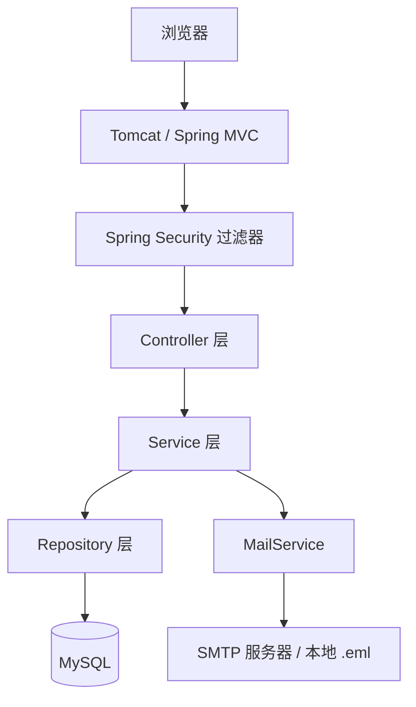
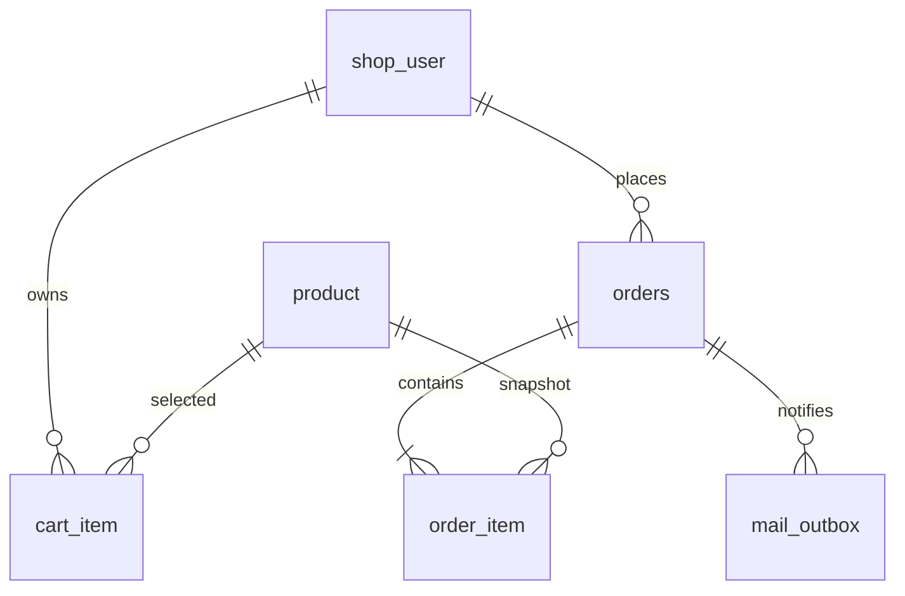
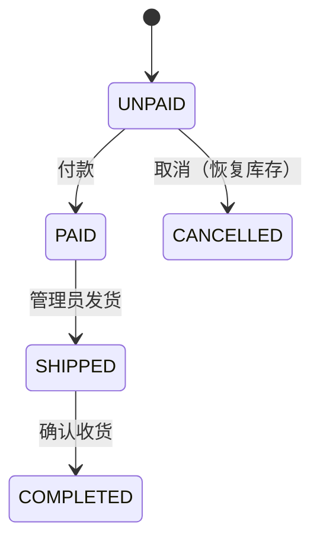

# 实验报告提纲

> 说明：本文件是写作结构，不是最终排版模板。学校 QQ 群共享目录里的模板下载后，把下面各节内容填进去，再统一字体、行距、页码和封面。
> 报告必须自己写，截图必须来自自己运行的系统。任务书明确：报告雷同按抄袭处理。

## 封面

- 实验题目：基于 Spring Boot 的校园图书商城设计与实现
- 学号：202430330460
- 姓名：方喆
- 班级：24计科双学位班
- 指导教师：布社辉
- 日期：【填写】

## 一、实验题目和要求

用自己的话复述任务书要求：

- 实现在线购物网站或同构 B/S 系统；
- 顾客端：注册、登录、注销、商品浏览/查询、购物车、付款、邮件确认发货、订单状态与历史；
- 管理端：商品目录增删改、订单管理、销售统计报表；
- 在线部署，提交后 3 个月内校园网可访问；
- 公开代码仓库，附 `readme.md`；
- 提交实验报告。

说明本项目选择“校园图书商城”作为实现主题，功能与在线购物网站同构。

## 二、需求分析

### 2.1 角色

| 角色 | 能力 |
|---|---|
| 游客 | 浏览商品、搜索、注册、登录 |
| 顾客 | 购物车、下单、模拟付款、取消、查看订单、确认收货 |
| 管理员 | 商品维护、上下架、查看全部订单、发货、查看销售报表 |

### 2.2 核心业务流程

```text
浏览/查询 → 加入购物车 → 提交订单 → 付款 → 管理员发货 → 顾客确认收货
```

### 2.3 业务规则

- 商品下架后前台不可见，也不能下单；
- 下单时校验库存，扣减失败则整单回滚；
- 未付款订单可以取消，取消后恢复库存；
- 只有已付款订单可以发货；
- 只有已发货订单可以确认收货；
- 已取消、已完成订单不能重复操作；
- 销售额只统计已付款、已发货、已完成订单。

## 三、总体设计

### 3.1 技术选型

- Spring Boot 4.1.1 + Spring MVC + Thymeleaf：服务端渲染，部署为单个 JAR；
- Spring JDBC：SQL 显式可见，便于说明实现；
- MySQL 8：事务和行锁支持完善；
- Spring Security：会话登录、BCrypt、角色权限、CSRF；
- JavaMail + 发件箱表：发货通知与失败重试。

### 3.2 分层结构



说明每层职责：

- Controller：接收参数、校验登录身份、选择页面、跳转；
- Service：业务规则、事务边界；
- Repository：参数化 SQL、行映射；
- 数据库：约束、外键、条件更新。

### 3.3 关键设计

- 金额使用整数“分”；
- 订单明细保存商品名和单价快照；
- 商品删除：默认逻辑下架；无历史订单可物理删除；有历史订单拒绝删除，保留快照和关联；
- 下单使用事务 + 条件扣库存 + 用户行锁；
- 邮件使用发件箱模式，事务提交后发送；
- 防重复提交使用 Session 一次性令牌。

## 四、数据库设计

### 4.1 表结构

| 表名 | 主要字段 | 说明 |
|---|---|---|
| product | id, name, category, description, price_cents, stock, active | 商品目录 |
| shop_user | id, email, name, password_hash, role | 账号与角色 |
| cart_item | user_id, product_id, quantity | 联合主键，购物车 |
| orders | id, user_id, status, total_cents, address, paid_at, tracking_no | 订单主表 |
| order_item | order_id, product_id, name, unit_price_cents, quantity | 成交快照 |
| mail_outbox | order_id, recipient, subject, body, status, error | 发件箱 |

### 4.2 ER 关系



### 4.3 设计说明

- 金额用 `INT`/`BIGINT` 存分，避免浮点误差；
- `cart_item` 使用 `(user_id, product_id)` 联合主键，天然去重；
- `orders.status` 用 CHECK 限制合法状态；
- 外键保证订单明细不会指向不存在的订单或商品；
- `order_item` 保存名称和单价快照，商品后续修改不影响历史订单；
- `mail_outbox` 记录邮件状态，支持失败重试。

## 五、详细实现

### 5.1 注册与登录

- 注册：校验邮箱格式、密码长度、两次密码一致；邮箱统一转小写；BCrypt 加盐哈希后入库。
- 登录：`UserDetailsService` 按邮箱加载用户；Spring Security 校验密码；登录后更换 Session，防止会话固定。
- 角色：数据库存 `CUSTOMER` / `ADMIN`，Spring Security 使用时映射为 `ROLE_` 前缀。
- CSRF：表单使用 `th:action` 自动带隐藏令牌；退出必须用 POST。

建议插入代码：`ShopUserDetailsService.java`、`SecurityConfig.java`、注册控制器片段。

### 5.2 商品查询

- Controller 接收 `q` 和 `category`；
- Repository 使用可选条件 SQL：

```sql
WHERE active = 1
  AND (? = '' OR name LIKE ? OR description LIKE ?)
  AND (? = '' OR category = ?)
```

- 参数全部使用 `?` 绑定，避免 SQL 注入；
- Thymeleaf 用 `th:each` 渲染商品卡片。

### 5.3 购物车

- 联合主键保证同一商品只有一行；
- 加购时累加数量，上限 99；
- 校验商品存在、在售、库存足够；
- 数量修改和移除均走 POST + CSRF。

### 5.4 下单事务（重点）

建议完整讲解 `OrderService.checkout`：

1. `@Transactional` 开启事务；
2. `SELECT ... FOR UPDATE` 锁定当前用户行，避免同一用户并发重复下单；
3. 读取购物车，空购物车拒绝；
4. 逐项执行条件扣库存：

```sql
UPDATE product
SET stock = stock - ?
WHERE id = ? AND active = 1 AND stock >= ?
```

5. 影响行数为 0 说明库存不足，抛异常；
6. 服务端计算总价，不接收前端金额；
7. 写 `orders` 和 `order_item` 快照；
8. 清空购物车；
9. 任意一步抛异常，整个事务回滚。

建议配一张“成功路径 + 库存不足回滚”的流程图或时序图，并附上测试截图。

### 5.5 订单状态机



说明每个 UPDATE 都带状态条件，例如：

```sql
UPDATE orders SET status = 'CANCELLED'
WHERE id = ? AND user_id = ? AND status = 'UNPAID'
```

影响 0 行就拒绝，既防越权，也防重复操作。

### 5.6 发货邮件

- 发货事务内更新订单状态并插入 `mail_outbox`；
- 事务提交后再调用 MailService 发送；
- 发送前用条件 UPDATE 把状态改为 `SENDING`，防止并发重复发送；
- 本地 `file` 模式写 `.eml`，生产 `smtp` 模式真实发送；
- 失败记录异常类型，后台可重试。

说明“为什么不在事务里发邮件”：外部网络调用不可控，邮件发出后事务回滚会造成错误通知。

### 5.7 后台商品管理

- 新增、编辑、上下架、删除（有历史订单时拒绝）；
- 价格输入“元”，用 `BigDecimal` 转“分”，拒绝超过两位小数；
- 无历史订单的商品可物理删除；有订单引用的商品拒绝删除，保留快照和关联。

### 5.8 销售统计

- 统计口径：PAID / SHIPPED / COMPLETED；
- 汇总：销售额、订单数、客单价、低库存数量；
- 每日趋势：按 `DATE(paid_at)` 分组，Service 补齐最近 30 天；
- 商品排行：按 `order_item` 的成交数量和金额汇总；
- 分类占比：关联 `product.category`；
- 图表使用单一蓝色序列 + 数据表，避免仅靠颜色传达信息。

## 六、功能测试

引用 `docs/测试用例.md` 的表格，挑选 8–12 条写入报告，附截图：

- 注册成功、重复邮箱；
- 登录成功、错误密码；
- 搜索和分类；
- 加入购物车、修改数量；
- 下单成功、库存不足回滚；
- 付款、取消恢复库存；
- 管理员发货、顾客确认收货；
- 邮件 `.eml` 和重试；
- 商品新增/下架；
- 统计报表。

写明测试环境、测试数据、预期结果和实际结果。失败重试的测试也要写，体现真实性。

截图编号、拍摄要求和隐私注意事项见 [screenshots/README.md](screenshots/README.md)。

## 七、部署

实际部署信息见 [部署记录.md](部署记录.md)。

部署完成后补充：

- 云服务商、实例配置、操作系统；
- JDK、MySQL、Nginx 安装；
- 数据库初始化与专用账号；
- 环境变量（数据库密码、SMTP 授权码）；
- systemd 服务配置；
- Nginx 反向代理配置；
- 安全组/防火墙端口；
- 校园网访问验证截图；
- 服务器购买期限：已购买一年，有效期至 2027 年 10 月，可覆盖本课程期末提交报告后的三个月；
- 从提交报告之日起三个月内保持校园网可正常访问的维护措施（服务自启、运行检查、日志、备份）。

## 八、AI 使用情况说明

（本节内容参考 [AI使用说明.md](AI使用说明.md) 和 [开发日志.md](开发日志.md) 整理，不能只写“使用了 AI”。）

- 使用工具与版本：
- 使用模块：
- 使用方式：先设计确认，再按模块生成；本人修改、运行验证、测试后再进入下一模块。
- 直接采纳的代码段：已在源码中用 `// AI-assisted` 标注，完整清单见 `docs/AI使用说明.md`。
- 自己修改或重写的部分：
- 验证方式与证据：手工测试用例、浏览器截图、数据库查询、编译和启动记录。
- 发现的问题与修正：例如 SQL 拼接、缺少 Bean 注解、Thymeleaf 表单嵌套、角色缓存等。
- 敏感信息处理：数据库密码在 `config/` 中且未提交；仓库不含密钥和真实密码。

## 九、总结与不足

建议写：

- 完成的功能和关键收获；
- 遇到的主要问题（例如事务回滚、库存并发、Thymeleaf 模板解析、邮件发送边界）；
- 不足：模拟支付、单机 Session、无分页、无商品图片、真实 SMTP 依赖部署环境；
- 后续改进方向。

## 十、写作注意事项

1. 不要直接复制参考样本的文案和截图；所有截图来自自己运行的系统。
2. 代码片段只放关键部分，配合解释，不要整页粘贴。
3. 统一术语：待付款 / 已付款 / 已发货 / 已完成 / 已取消。
4. 金额统一写成“分”或“元”，不要混用。
5. 部署地址、测试账号和口令按任务书要求写清楚；口令不要与个人常用密码相同。
6. 报告完成后做一次查重自检，确保没有大段与他人相同的文字。
